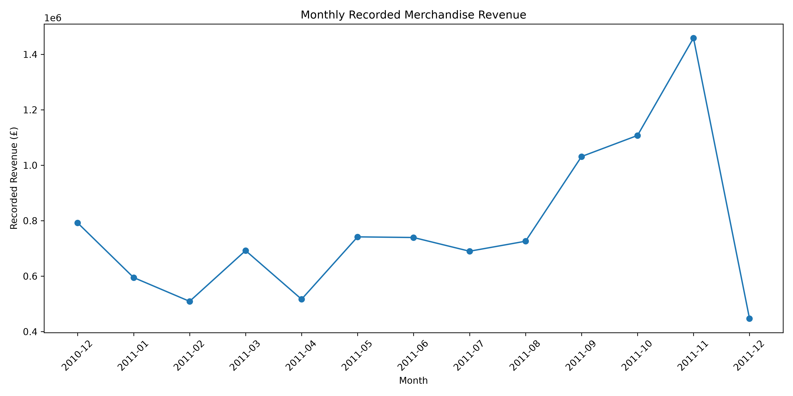
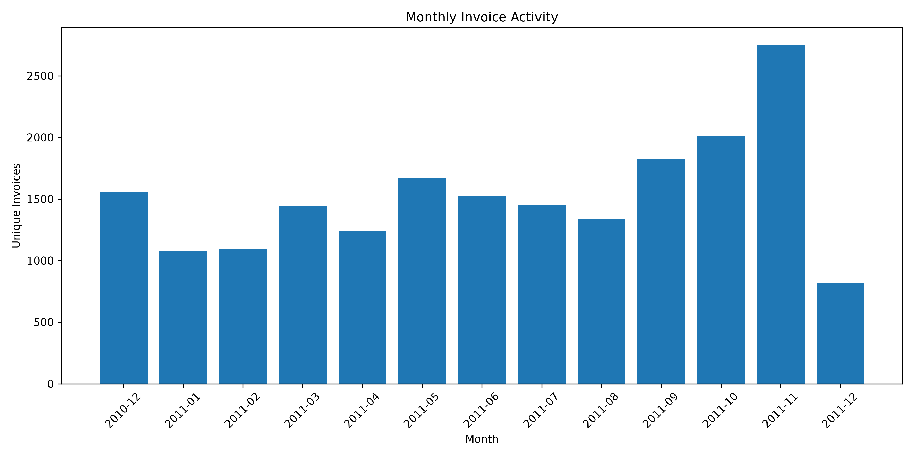
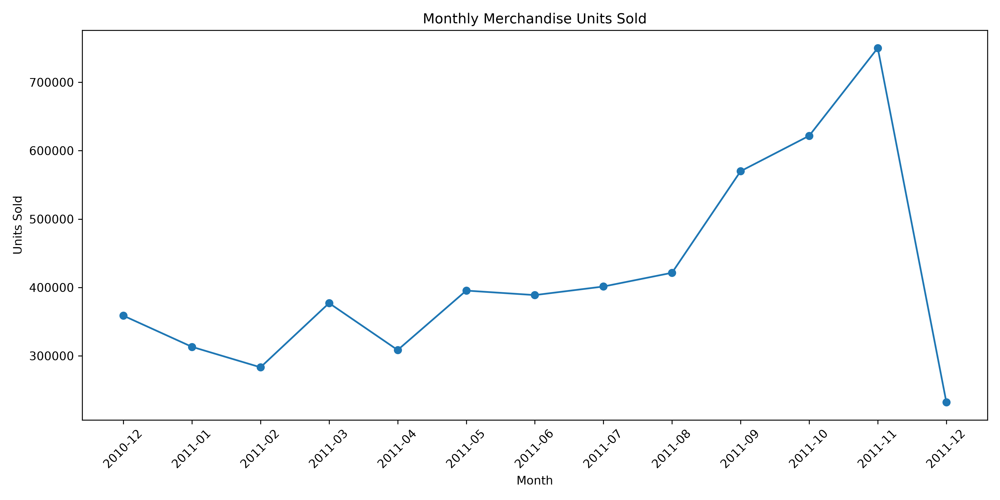
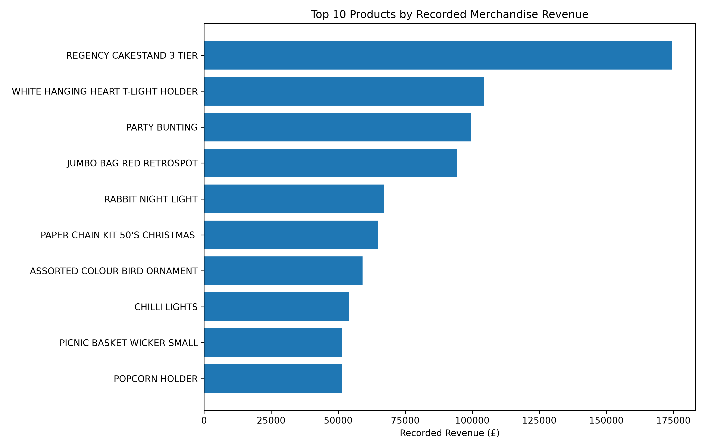
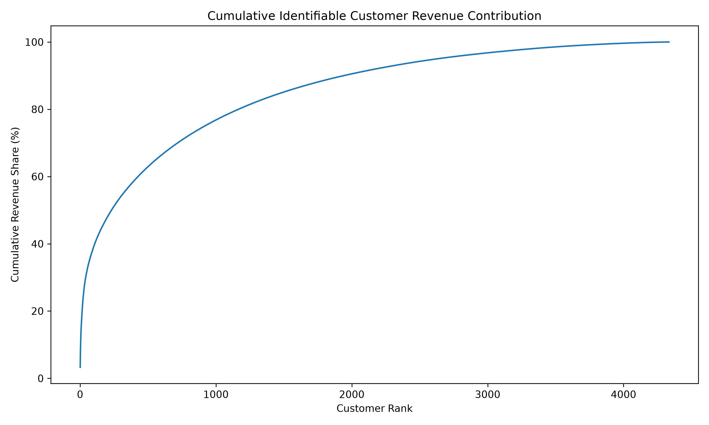
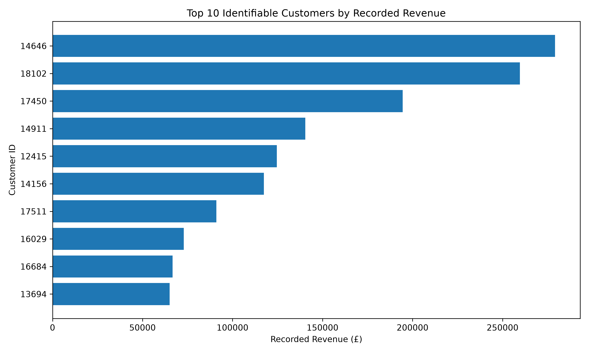

# Retail Business Performance Analysis

**An independent Foundations of Data Science project using the PACE framework**

## Business question

Which products, customers, and sales periods contribute most to revenue in a historical online retail business, and what evidence-based actions could management consider to improve sales performance?

## Project overview

This project uses the UCI Online Retail dataset, a real transaction-level dataset from a UK-based online retailer. The original data covers transactions from **1 December 2010 to 9 December 2011** and contains **541,909 records**.

The project follows the PACE framework:

1. **Plan** — define the business problem, stakeholders, objectives, and analytical questions.
2. **Analyze** — inspect the dataset, assess data quality, and identify patterns worth investigating.
3. **Construct** — prepare analysis-ready data, calculate business metrics, and create visual evidence.
4. **Execute** — communicate findings, limitations, and practical recommendations.

## Initial analytical questions

- Which products contribute the most to recorded revenue?
- Which countries account for the largest share of recorded revenue?
- How does recorded revenue change month by month?
- How common are cancellations, returns, and unusual transaction values?
- What limitations should management consider before acting on the results?

## Dataset

- **Source:** UCI Machine Learning Repository — Online Retail
- **Creator:** Daqing Chen
- **DOI:** https://doi.org/10.24432/C5BW33
- **Dataset page:** https://archive.ics.uci.edu/dataset/352/online+retail
- **License:** CC BY 4.0

Download `Online Retail.xlsx` from the UCI page and place it in `data/raw/`.

The dataset includes invoice number, product code, product description, quantity, invoice date, unit price, customer ID, and country. Invoice numbers beginning with `C` indicate cancellations. Negative quantities may represent returns. Missing customer IDs and other data-quality issues must be investigated rather than silently ignored.

## Important measurement note

We will calculate **recorded line revenue** as `Quantity × UnitPrice`. This is not the same as profit: the dataset does not provide product costs, operating expenses, or full margin information. Any recommendations will respect that limitation.

## Repository structure

```text
Foundations-of-Data-Science-Project/
├── data/
│   ├── raw/                 # Original dataset; do not commit large raw files
│   └── processed/           # Cleaned/derived data (review before committing)
├── notebooks/
│   └── 01_initial_data_understanding.ipynb
├── reports/                 # Written findings and project report
├── visualizations/          # Exported charts
├── .gitignore
├── PROJECT_PLAN.md
├── DATA_DICTIONARY.md
└── requirements.txt
```

## Reproducibility

Use Python 3.10+ and install the dependencies:

```bash
pip install -r requirements.txt
```

Open the notebook and run the cells in order.

## Current status

- [x] Business problem selected
- [x] Dataset source selected
- [x] Initial project structure created
- [ ] Download dataset
- [ ] Complete initial data inspection
- [ ] Document data-quality findings
- [ ] Continue through PACE stages


## Key findings

The analysis produced the following findings using the
sensitivity-analysis dataset:

- **Recorded merchandise revenue:** £10,047,508.36.
- **Products analysed:** 3,916 stock codes.
- **Identifiable customers:** 4,334.
- **Countries represented:** 38.
- **United Kingdom revenue contribution:** 84.78%.
- **International revenue contribution:** 15.22%.
- **Top 10 products:** 8.17% of recorded merchandise revenue.
- **Top 20 identifiable customers:** 22.78% of identifiable-customer revenue.
- **Multi-month purchasing activity:** 62.21% of identifiable customers.
- **Highest recorded revenue month:** November 2011.

These results describe historical recorded transaction
values. They should not be interpreted as profit or
verified net sales.

## Visualizations

The project includes nine exported visualizations:

### Geographical performance


### Monthly sales performance







### Product performance




### Customer analysis






## Final report and project outputs

The repository contains:

- `reports/final_business_analysis.md` — complete business analysis report.
- `reports/business_findings.csv` — consolidated analytical findings.
- `data/processed/merchandise_cleaned.csv` — prepared merchandise dataset generated locally by the notebook; excluded from GitHub because of its file size.
- `visualizations/` — exported analytical charts.
- `notebooks/01_initial_data_understanding.ipynb` — exploratory analysis and data preparation.

## Analytical limitations

The findings have several important limitations:

- The dataset represents historical transactions from 2010–2011.
- Approximately 24.9% of merchandise records have missing CustomerIDs.
- Two fully cancelled transactions were independently verified and excluded in a sensitivity scenario. Broader cancellation matching remained ambiguous.
- Exact duplicate records were retained in the primary analysis because identical rows do not necessarily establish accidental duplication.
- Product costs, operating expenses, and profit margins are unavailable.
- December 2011 is an incomplete observation period.

Accordingly, recorded merchandise revenue is not equivalent
to profit or definitive net sales. Customer and product
findings should be interpreted within the documented
data-quality limitations.

## Attribution

Chen, D. (2015). *Online Retail* [Dataset]. UCI Machine Learning Repository. https://doi.org/10.24432/C5BW33
