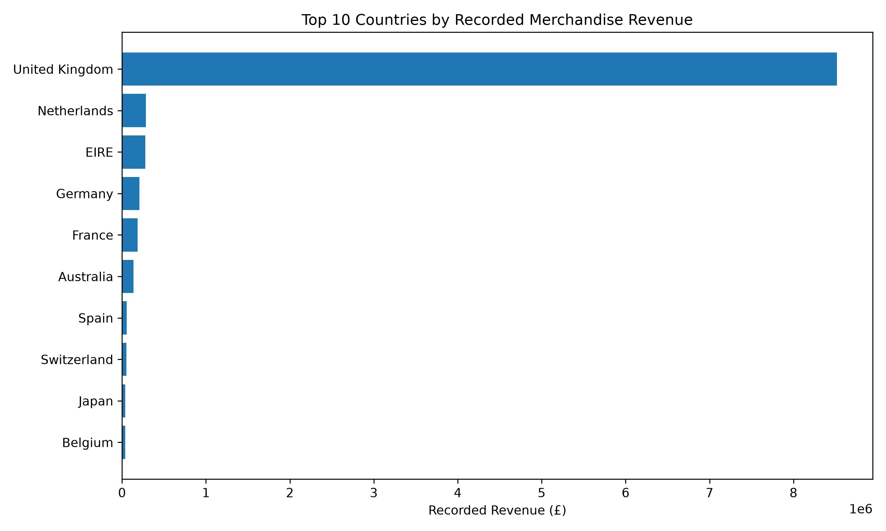
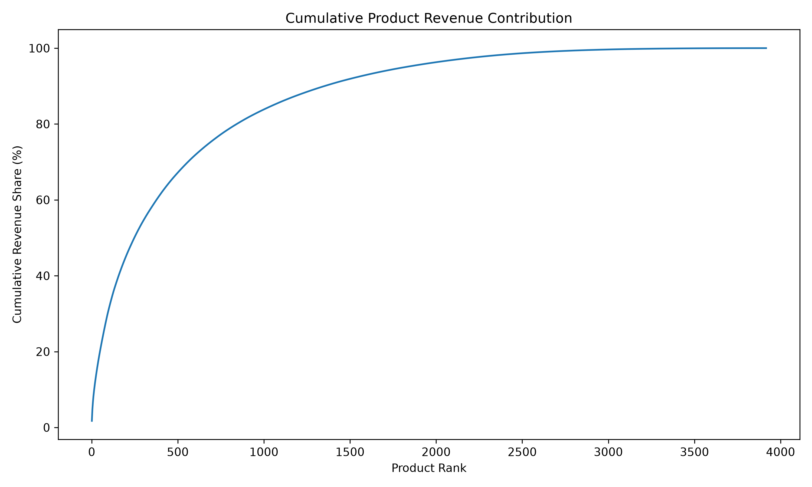
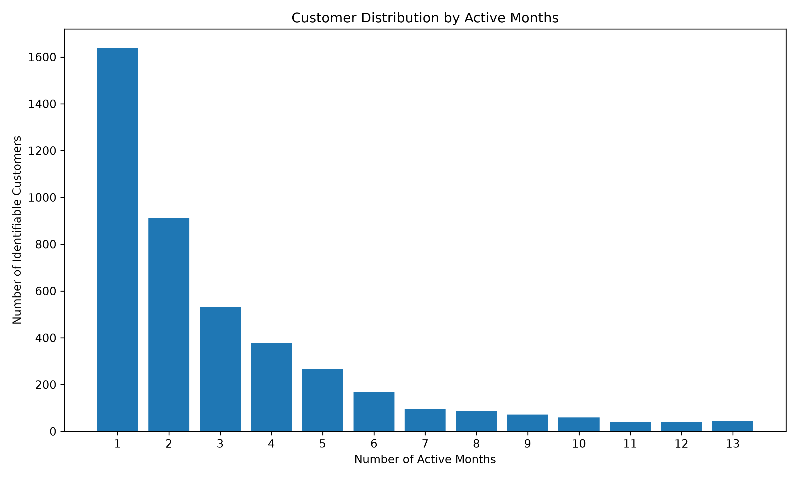

# RETAIL BUSINESS PERFORMANCE ANALYSIS

**Turning transaction data into business insights with Python, data analysis, and the PACE framework.**

[](https://www.python.org/)
[](https://jupyter.org/)
[](https://pandas.pydata.org/)
[](https://numpy.org/)
[](https://matplotlib.org/)


---

## Project Overview

How can a business use historical transaction data to understand its products, customers, and sales performance?

This project investigates that question using the **UCI Online Retail dataset**, containing 541,909 transaction records from a UK-based online retailer between December 2010 and December 2011.

Using Python and the PACE framework, I conducted data exploration, data-quality assessment, transaction analysis, customer and product analysis, and visualization to identify patterns that could support better business decisions.

**The central objective:** transform raw transactional information into clear, evidence-based business insights while documenting the limitations of the data.

## Business Problem

Management needs to understand:

- Which products contribute most to recorded merchandise revenue?
- How concentrated is revenue across products and customers?
- Which countries contribute most to recorded transaction value?
- How does sales activity change over time?
- What data-quality issues could affect business decisions?

The analysis examines these questions and develops practical recommendations based on the available evidence.

## Key Findings

<details>
<summary><strong>View analytical highlights</strong></summary>

| Metric | Finding |
|---|---:|
| Recorded merchandise revenue | £10,047,508.36 |
| Products analysed | 3,916 stock codes |
| Identifiable customers | 4,334 |
| Countries represented | 38 |
| UK revenue contribution | 84.78% |
| International revenue contribution | 15.22% |
| Top 10 products' revenue share | 8.17% |
| Top 20 customers' revenue share | 22.78% |
| Customers active across multiple months | 62.21% |
| Highest recorded revenue month | November 2011 |

*These figures use the documented sensitivity-analysis dataset. Customer concentration and multi-month activity calculations use identifiable CustomerID records.*

</details>

## Analytical Framework — PACE

The project follows the four stages of the PACE framework.

| Stage | What I did |
|---|---|
| **Plan** | Defined the business problem, objectives, and analytical questions. |
| **Analyze** | Explored transaction records, investigated missing values, duplicates, cancellations, and unusual entries. |
| **Construct** | Prepared analysis-ready data, calculated metrics, and developed visualizations. |
| **Execute** | Interpreted findings, documented limitations, and developed evidence-based recommendations. |

## Visual Analysis

The following charts summarize the main analytical findings.

### 1. Geographical Performance



The United Kingdom represents the largest share of recorded merchandise revenue. International contributions provide additional context for understanding the retailer's geographical distribution.

### 2. Monthly Sales Performance


November 2011 recorded the highest monthly merchandise revenue in the analysis period. December 2011 is incomplete, so it should not be compared directly with full months.

### 3. Product Performance




Product concentration analysis helps identify how much recorded revenue is associated with a relatively small portion of the product catalogue.

### 4. Customer Analysis





Customer analysis examines revenue concentration and purchasing activity across calendar months. Multi-month activity is an observed purchasing pattern, not a formal customer-retention measure.

## Data and Methodology

**Dataset:** UCI Machine Learning Repository — Online Retail

- Creator: Daqing Chen
- Original records: 541,909
- Original period: 1 December 2010 – 9 December 2011
- Original variables: 8
- Dataset DOI: [10.24432/C5BW33](https://doi.org/10.24432/C5BW33)
- Dataset source: [UCI Online Retail](https://archive.ics.uci.edu/dataset/352/online+retail)

### Data Preparation

The analysis investigated:

- Missing customer identifiers and product descriptions.
- Duplicate transaction records.
- Cancellation invoices and negative quantities.
- Zero and non-positive unit prices.
- Special transaction codes and non-merchandise entries.
- Ambiguous cancellation matching.

The merchandise analysis retained qualifying positive-quantity, positive-price transaction lines and excluded identified special transaction codes and cancellation invoices.

A separate sensitivity analysis excluded two original invoice records for which full cancellation was independently verified.

### Important Measurement Definition

Recorded line revenue is calculated as:

`Quantity × UnitPrice`

**Recorded revenue is not profit.** The dataset does not include product costs, operating expenses, or complete margin information.

The sensitivity-analysis result is also not verified net sales: broader cancellation matching remained ambiguous, and the analysis does not establish a complete accounting reconciliation.

## Business Recommendations

Based on the observed patterns, management could consider:

1. **Product portfolio review:** examine high-contribution products and investigate products with consistently low recorded revenue.
2. **Inventory planning:** use monthly product and sales patterns as an input to inventory planning, while validating against more recent data.
3. **Customer analysis:** investigate purchasing patterns among identifiable customers and improve customer identification coverage.
4. **Geographical analysis:** evaluate international markets using additional information about costs, demand, logistics, and profitability.
5. **Data-quality controls:** improve the recording of cancellations, returns, customer identifiers, and unusual transaction entries.

These are recommendations for further investigation, not proven causal outcomes.

## Repository Structure

```text
Foundations-of-Data-Science-Project/
│
├── Data/
│   ├── raw/
│   └── processed/
│
├── Docs/
│   └── 01_initial_data_observations.md
│
├── Notebooks/
│   └── 01_initial_data_understanding.ipynb
│
├── Reports/
│   ├── business_findings.csv
│   └── final_business_analysis.md
│
├── Visualizations/
│   ├── 01_top_countries.png
│   ├── 02_monthly_revenue.png
│   ├── 03_top_products.png
│   ├── 04_customer_revenue_concentration.png
│   ├── 05_product_revenue_concentration.png
│   ├── 06_monthly_invoice_activity.png
│   ├── 07_customer_active_months.png
│   ├── 08_top_customers.png
│   └── 09_monthly_units_sold.png
│
├── DATA_DICTIONARY.md
├── PROJECT_PLAN.md
├── README.md
├── requirements.txt
└── .gitignore
```

## Reproducibility

To reproduce the analysis:

**1. Clone the repository**

```bash
git clone https://github.com/yashkeram/Foundations-of-Data-Science-Project.git
cd Foundations-of-Data-Science-Project
```

**2. Create and activate a virtual environment**

```bash
python -m venv .venv
```

Windows PowerShell:

```powershell
.venv\Scripts\Activate.ps1
```

**3. Install dependencies**

```bash
pip install -r requirements.txt
```

**4. Download the dataset**

Download `Online Retail.xlsx` from the [UCI dataset page](https://archive.ics.uci.edu/dataset/352/online+retail) and place it inside:

```text
Data/raw/
```

**5. Run the notebook**

```bash
jupyter notebook
```

Open `Notebooks/01_initial_data_understanding.ipynb` and execute the cells in order.

The raw Excel file and generated processed dataset are excluded from version control. They must be generated or downloaded locally before reproducing the analysis.

## Limitations and Research Considerations

This project has several important limitations:

- The dataset covers historical transactions from 2010–2011, not current retail conditions.
- Approximately 24.9% of merchandise records have missing CustomerIDs.
- Cancellation matching is incomplete and contains ambiguous cases.
- Exact duplicate records were retained in the primary analysis because identical records do not automatically prove accidental duplication.
- December 2011 is an incomplete observation period.
- Product costs, operating expenses, and profit margins are unavailable.
- Customer purchasing across multiple months does not establish formal retention or customer loyalty.

All findings should therefore be interpreted as historical transaction analysis rather than a complete assessment of business profitability.

## Project Deliverables

| Deliverable | Location |
|---|---|
| Exploratory analysis | `Notebooks/` |
| Initial data observations | `Docs/` |
| Consolidated findings | `Reports/business_findings.csv` |
| Complete business report | `Reports/final_business_analysis.md` |
| Visualizations | `Visualizations/` |
| Data definitions | `DATA_DICTIONARY.md` |
| Project planning | `PROJECT_PLAN.md` |

## Dataset Attribution

Chen, D. (2015). *Online Retail* [Dataset]. UCI Machine Learning Repository.

[Dataset DOI](https://doi.org/10.24432/C5BW33) · [Dataset page](https://archive.ics.uci.edu/dataset/352/online+retail)

The dataset is licensed under [CC BY 4.0](https://creativecommons.org/licenses/by/4.0/).

---

**An independent data-analysis project focused on learning how data can support business understanding and decision-making.**